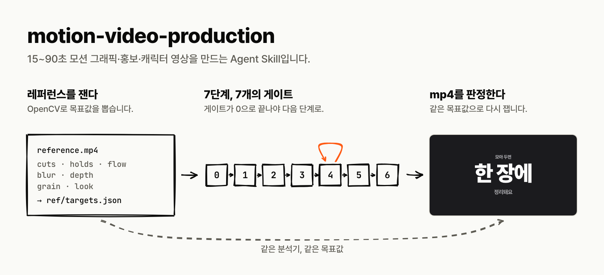
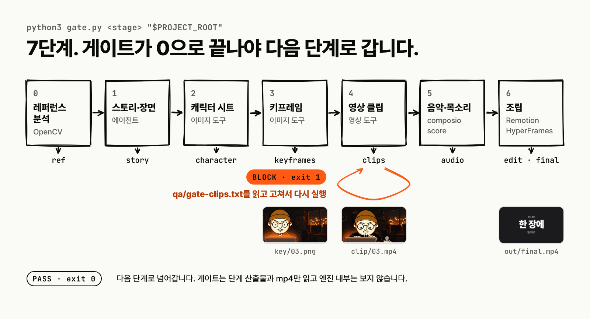

# motion-video-production

[English](README.md) · **한국어**

[](https://github.com/unclejobs-ai/motion-video-skill/stargazers) [](LICENSE) [](docs/runtimes.md)



15~90초 모션 그래픽, 홍보 영상, 캐릭터 영상을 만드는 Agent Skill이에요. 에이전트가 7단계로 작업하고, 단계마다 스크립트가 결과를 검사해요. 통과해야 다음 단계로 넘어가요.

Codex, Claude Code 등 Agent Skills를 읽는 런타임에서 쓸 수 있어요.

## 설치

영상 프로젝트 폴더에서 실행해요.

```bash
npx skills add unclejobs-ai/motion-video-skill --skill motion-video-production
```

모든 프로젝트에서 쓰려면 `--global`을 붙여요. 수동 설치와 런타임별 경로는 [docs/runtimes.md](docs/runtimes.md)에 있어요.

Node.js 24 이상, ffmpeg, Python 3, Bash가 필요해요. Windows에서는 WSL을 써요.

## 사용

에이전트에게 이렇게 말해요.

> 이 레퍼런스 영상 느낌으로 20초짜리 홍보 영상 만들어 줘.

이름으로 부를 수도 있어요. Codex는 `$motion-video-production`, Claude Code와 Cursor는 `/motion-video-production`이에요.

에이전트는 먼저 여섯 가지를 물어요. 어디에 올릴지, 길이와 화면비, 가진 도구, 피할 것, 레퍼런스 영상, 엔진이에요. 그다음 단계별로 진행해요. 이미지·영상 생성 도구가 없으면 프롬프트를 써 주고, 만들어 온 파일을 받아 이어가요.

## 작동 방식



| 단계 | 게이트 | 검사 |
|---|---|---|
| 0. 레퍼런스 | `ref` | 컷, 움직임, 흐림, 그레인, 룩을 숫자로 기록. 완성본도 같은 방식으로 측정 |
| 1. 스토리 | `story` | BPM, 음악 싱크 표, 장면 표 |
| 2. 캐릭터 | `character` | 한 문단 묘사, 색, 시트 이미지 |
| 3. 키프레임 | `keyframes` | 중복, 화면비 |
| 4. 클립 | `clips` | 길이, 프레임 수, 첫 프레임 일치, 프레임 스트립 |
| 5. 음악·목소리 | `audio` | 목소리 ID 하나, 대사 파일 |
| 6. 편집 | `edit`, `final` | 박자 격자, 컷 연결, 대사 길이, 음량 |

종료 코드 `0`이면 다음 단계로 가요. `1`이면 `qa/gate-<단계>.txt`에 적힌 줄을 고치고 다시 돌려요. 클립 1초 뒤에 얼굴이 달라지는 것처럼 눈으로만 볼 수 있는 문제도 있어요. 이런 항목은 사람이 프레임 스트립을 보고 검토 기록을 남겨야 통과해요.

## 데모 돌려 보기

Remotion으로 5초짜리 타이포그래피 영상을 렌더해요. 30초쯤 걸려요.

```bash
SKILL_ROOT="$PWD/.agents/skills/motion-video-production"  # 설치된 경로
mkdir engine && cp -R "$SKILL_ROOT/engines/remotion/." engine
cd engine && npm ci
node pipeline/probe.mjs productions/carry-demo  # carry 1.00 PASS
node pipeline/render.mjs carry-demo             # renders/carry-demo/picture.mp4
```


첫 줄이 작아지면서 다음 장면의 라벨이 돼요. `probe.mjs`는 렌더 전에 모든 컷에서 화면 요소가 하나라도 이어지는지 검사해요.

## 들어 있는 것

- **엔진 두 개.** Remotion에는 carry 검사와 wordcut 템플릿이 있어요. HyperFrames는 HTML/CSS를 GSAP으로 움직여 렌더해요. [어느 쪽을 쓸지](skills/motion-video-production/references/engines.md)
- **레퍼런스 분석.** OpenCV로 레퍼런스 영상을 목표 숫자로 바꿔요. [설명](skills/motion-video-production/references/reference-analysis.md)
- **목소리와 음악.** composio CLI로 ElevenLabs, Fish Audio 목소리를 쓰고, 박자에 맞춘 음악을 만들어요.
- **타임라인 편집기.** 그림, 자막, 목소리, 음악 트랙을 브라우저에서 편집해요. 에이전트와 같은 `edit.json`을 고쳐요. [자세히](skills/motion-video-production/timeline/README.md)


## 문서

에이전트가 필요할 때 읽어요.

- [`SKILL.md`](skills/motion-video-production/SKILL.md): 단계 순서와 게이트 호출
- [`references/`](skills/motion-video-production/references/): 아트 디렉션, 박자 격자, 일관성, 도구, 비용
- [`references/gotchas.md`](skills/motion-video-production/references/gotchas.md): 자주 겪는 실패 29가지
- [`docs/runtimes.md`](docs/runtimes.md): 설치 경로, 알려진 한계, 검증 범위 (영어)

## 라이선스

MIT예요. Remotion은 직원 4명 이상 회사라면 유료 Company License가 필요해요. HyperFrames는 Apache-2.0이에요. 외부 도구 조건은 [`NOTICE.md`](NOTICE.md)에 있어요.

[SceneSteller](https://www.scenesteller.com/?utm_source=github&utm_medium=readme&utm_campaign=motion-video-skill)를 만드는 팀이 만들었어요.
