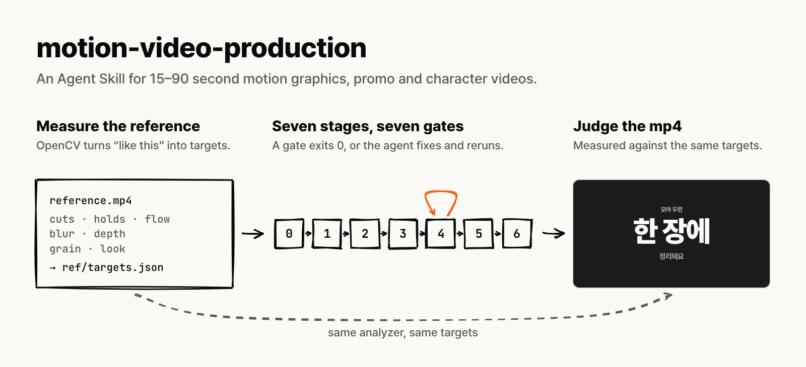
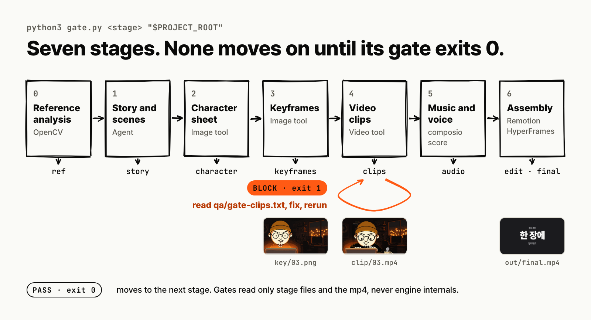
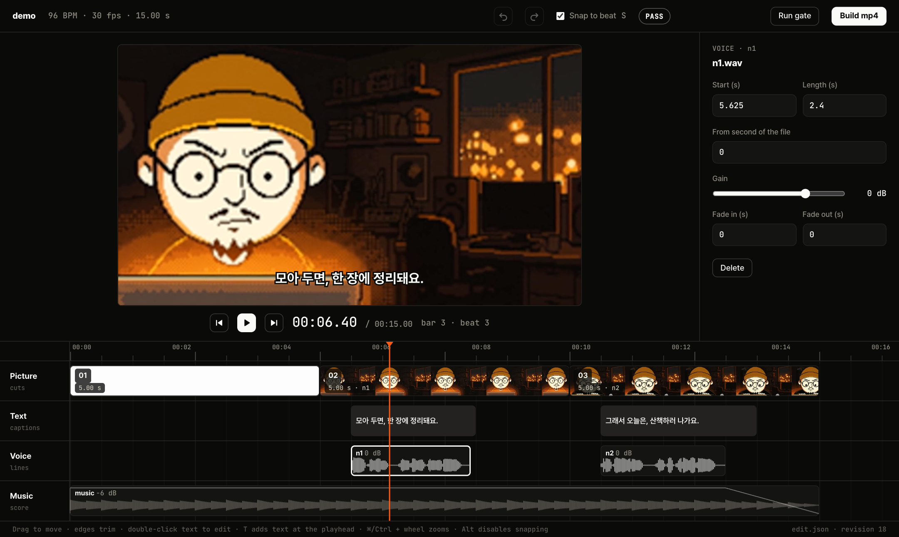

# motion-video-production

**English** · [한국어](README.ko.md)

[](https://github.com/unclejobs-ai/motion-video-skill/stargazers) [](LICENSE) [](docs/runtimes.md)



An Agent Skill for 15–90 second motion graphics, promo and character videos. The agent works in seven stages. After each stage a script checks the output, and the next stage waits until it passes.

Works in Codex, Claude Code and other runtimes that read Agent Skills.

## Install

Run this in your video project folder:

```bash
npx skills add unclejobs-ai/motion-video-skill --skill motion-video-production
```

Add `--global` to install it for all projects. For manual install and per-runtime paths, see [docs/runtimes.md](docs/runtimes.md).

You need Node.js 24+, ffmpeg, Python 3 and Bash (WSL on Windows).

## Use

Ask your agent:

> Make a 20-second promo that feels like this reference video.

You can also call it by name: `$motion-video-production` in Codex, `/motion-video-production` in Claude Code and Cursor.

The agent asks six questions first: where the video goes, length and aspect ratio, which tools you have, what to avoid, the reference video, and which engine to use. Then it works through the stages. If you have no image or video generator, it writes the prompts and picks up from the files you bring back.

## How it works



| Stage | Gate | Checks |
|---|---|---|
| 0. Reference | `ref` | Cuts, motion, blur, grain and look as numbers. The final render is measured the same way |
| 1. Story | `story` | BPM, music sync table, scene table |
| 2. Character | `character` | One-paragraph description, colors, sheet image |
| 3. Keyframes | `keyframes` | Duplicates, aspect ratio |
| 4. Clips | `clips` | Duration, frame count, start-frame match, frame strips |
| 5. Music and voice | `audio` | One voice ID, dialogue files |
| 6. Edit | `edit`, `final` | Beat grid, cut continuity, dialogue length, loudness |

Exit code `0` means move on. Exit code `1` means fix the lines listed in `qa/gate-<stage>.txt` and run the gate again. Some things only eyes can judge, such as a face drifting a second into a clip. Those pass only after someone looks at the frame strips and writes a review.

## Try the demo

This renders a 5-second typography clip with Remotion. It takes about 30 seconds.

```bash
SKILL_ROOT="$PWD/.agents/skills/motion-video-production"  # your install path
mkdir engine && cp -R "$SKILL_ROOT/engines/remotion/." engine
cd engine && npm ci
node pipeline/probe.mjs productions/carry-demo  # carry 1.00 PASS
node pipeline/render.mjs carry-demo             # renders/carry-demo/picture.mp4
```


The first line shrinks into the label of the next scene. `probe.mjs` checks before rendering that something on screen carries across every cut.

## What's inside

- **Two engines.** Remotion has the carry probe and a wordcut template. HyperFrames renders plain HTML/CSS with GSAP. [Which one to use](skills/motion-video-production/references/engines.md)
- **Reference analysis.** OpenCV turns a reference video into target numbers. [How it works](skills/motion-video-production/references/reference-analysis.md)
- **Voice and music.** ElevenLabs and Fish Audio voices through the composio CLI, plus a procedural score on the beat.
- **Timeline editor.** Picture, text, voice and music tracks in the browser. It edits the same `edit.json` the agent does. [Details](skills/motion-video-production/timeline/README.md)



## Docs

The agent reads these as it needs them. Most are written in Korean, and gate output is in Korean too. The agent still answers in your language.

- [`SKILL.md`](skills/motion-video-production/SKILL.md): stage order and gate calls
- [`references/`](skills/motion-video-production/references/): art direction, beat grid, consistency, providers, cost
- [`references/gotchas.md`](skills/motion-video-production/references/gotchas.md): 29 known failure modes
- [`docs/runtimes.md`](docs/runtimes.md): install paths, known limitations, what was tested

## License

MIT. Remotion needs a paid Company License if your company has four or more people. HyperFrames is Apache-2.0. Third-party terms are in [`NOTICE.md`](NOTICE.md).

Made by the team behind [SceneSteller](https://www.scenesteller.com/?utm_source=github&utm_medium=readme&utm_campaign=motion-video-skill).
