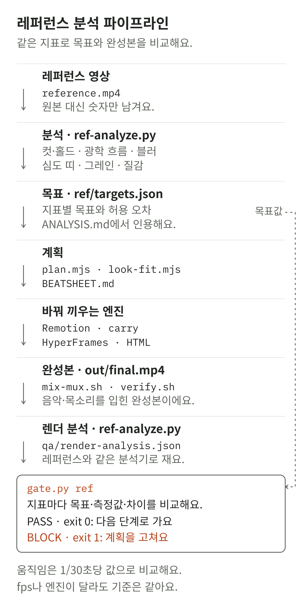
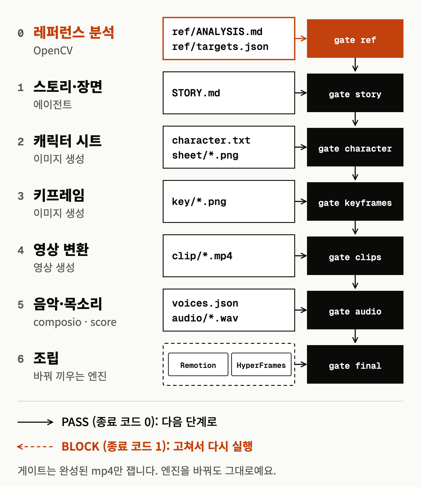
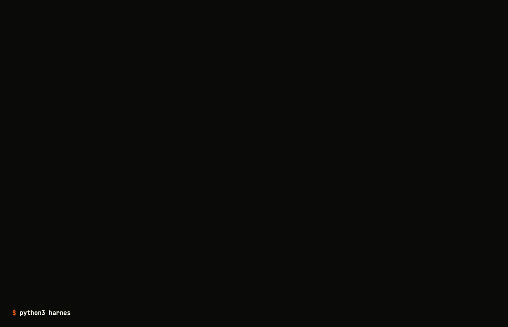
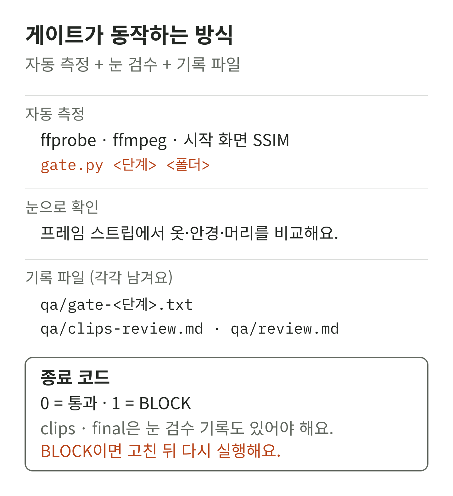
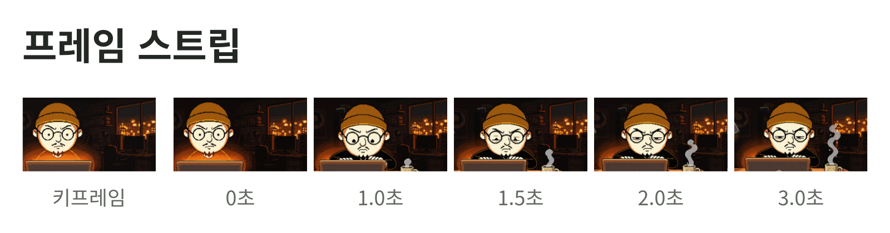
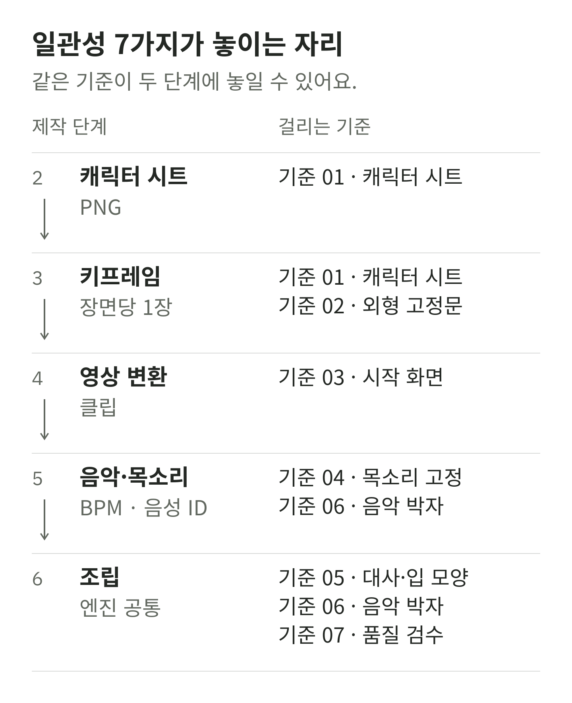

<p>
  
</p>

# motion-video-production

**한국어** · [English](README.en.md)

모션 그래픽, 홍보 영상, 캐릭터 영상(15~90초)을 처음부터 끝까지 만드는 **Agent Skills 형식의 제작 스킬**이에요. Codex, Claude Code 및 다른 스킬 지원 런타임에서 같은 스킬 폴더를 써요.
단계마다 산출물을 재서 통과 여부를 종료 코드로 판정하는 게이트(`harness/gate.py`)가 있어요. 레퍼런스 영상을 숫자로 분해하는 분석기와, 바로 렌더할 수 있는 엔진 두 개(Remotion, HyperFrames)도 함께 들어 있어요.

**바로 가기** · [설치](#설치) · [60초 시작](#60초-시작) · [풀 버전이 더하는 것](#풀-버전이-더하는-것) · [레퍼런스 분석](#레퍼런스-분석) · [사용 흐름](#사용-흐름) · [하네스](#하네스) · [필요한 도구](#필요한-도구) · [검증 범위](#검증-범위)

---

## 설치

### 공통 설치 (Codex·Claude Code·다른 런타임)

스킬을 쓸 프로젝트 폴더에서 실행해요. Node.js와 npx가 필요하고, 쓸 런타임을 골라 설치해요.

```bash
npx skills add unclejobs-ai/motion-video-skill --skill motion-video-production
```

Codex만 지정하려면 아래처럼 실행해요. 개인 범위로 설치하려면 `--global`을 더해요.

```bash
npx skills add unclejobs-ai/motion-video-skill --skill motion-video-production --agent codex
```

[Vercel skills CLI](https://github.com/vercel-labs/skills)가 Codex, Claude Code, Gemini CLI, Cursor, GitHub Copilot, OpenCode, Amp, Antigravity, Windsurf 등의 설치 위치를 처리해요. 엔진은 스킬 폴더 안에 있어서 함께 설치돼요. **설치 호환성과 전체 영상 제작 검증은 달라요.** [런타임별 설치·호출과 검증 범위](docs/runtimes.md)를 참고해요.

<details>
<summary><strong>수동 설치 (Node.js 없이)</strong></summary>

Codex는 프로젝트 `.agents/skills/`와 개인 `~/.agents/skills/`에서 스킬을 읽어요. 아래는 개인 설치 예시예요.

```bash
git clone https://github.com/unclejobs-ai/motion-video-skill.git
mkdir -p ~/.agents/skills
cp -r motion-video-skill/skills/motion-video-production ~/.agents/skills/
```

Claude Code는 프로젝트 `.claude/skills/`와 개인 `~/.claude/skills/`에서 스킬을 읽어요. 기존 설치 명령도 그대로 쓸 수 있어요.

```bash
git clone https://github.com/unclejobs-ai/motion-video-skill.git
mkdir -p ~/.claude/skills
cp -r motion-video-skill/skills/motion-video-production ~/.claude/skills/
```

한 프로젝트에서만 쓰려면 그 프로젝트의 런타임별 스킬 폴더에 같은 폴더를 복사해요. 한 런타임에 같은 이름을 여러 경로로 중복 설치하지 않아요.

</details>

### 첫 요청

설치한 뒤 런타임의 스킬 목록에서 `motion-video-production`을 확인해요. 보이지 않으면 런타임을 새로 시작해요. Codex에서는 `$motion-video-production`, Claude Code와 Cursor에서는 `/motion-video-production`으로 부르거나 아래처럼 요청해요.

> 이 레퍼런스 영상 느낌으로 20초짜리 홍보 영상을 만들고 싶어.

에이전트가 먼저 6가지(공개 방식, 길이와 화면비, 쓸 수 있는 도구, 금지 요소, 레퍼런스 영상, 엔진)를 묻고 단계 순서대로 진행해요. 생성 도구가 없으면 프롬프트를 건네고, 사용자가 만든 파일을 받아 이어가요.

## 60초 시작

설치된 스킬에서 엔진을 작업 폴더로 복사해 데모 하나를 렌더하는 순서예요. Node.js 24 이상과 ffmpeg가 필요해요. 스킬 폴더 안에서는 설치하지 않아요.

```bash
SKILL_ROOT="$PWD/.agents/skills/motion-video-production"   # 실제 설치 경로
cp -R "$SKILL_ROOT/engines/remotion" engine && cd engine && npm ci
node pipeline/probe.mjs productions/carry-demo              # carry 1.00 PASS
node pipeline/render.mjs carry-demo --stills 1.5 3.0        # renders/carry-demo/contact.png
node pipeline/render.mjs carry-demo                         # renders/carry-demo/picture.mp4
node pipeline/score.mjs productions/carry-demo              # 절차적 스코어
bash "$SKILL_ROOT/scripts/mix-mux.sh" renders/carry-demo/picture.mp4 60 5 productions/carry-demo/audio/score.wav - out/final.mp4
bash "$SKILL_ROOT/scripts/verify.sh" out/final.mp4
```

렌더 브라우저는 `CHROME_PATH`나 캐시된 Playwright 헤드리스 셸을 써요. 둘 다 없으면 `npx remotion browser ensure`가 내려받아요(먼저 물어봐요).

## 풀 버전이 더하는 것

| 무엇 | 하는 일 | 위치 |
|---|---|---|
| Remotion 엔진 | 버전이 고정된 렌더 파이프라인, 모션 모듈, 데모 | `engines/remotion/` |
| carry 검사 | 경계마다 화면 요소가 살아남는지를 렌더 전에 숫자로 재요 | `pipeline/carry.ts`, `probe.mjs` |
| wordcut 템플릿 | 단어 하나를 한 자리에 두고 여러 장면이 넘겨받는 영상. `data.ts`만 바꿔요 | `productions/wordcut/` |
| 질감 맞추기 | 레퍼런스의 대비·색·그레인·심도에 렌즈 값을 맞춰요 | `look-fit.mjs` |
| 목소리와 음악 | composio CLI로 ElevenLabs·Fish Audio 목소리, 타이밍에 맞춘 절차적 스코어 | `vo.mjs`, `score.mjs` |
| HyperFrames 엔진 | HTML/CSS 페이지를 GSAP으로 움직여 mp4로 렌더해요 | `engines/hyperframes/` |
| 레퍼런스 분석 | 레퍼런스 영상을 OpenCV로 분해해 목표값을 만들어요 | `scripts/ref-analyze.py` |

엔진은 바꿔 끼울 수 있어요. carry와 wordcut이 필요하면 Remotion, 재료가 웹페이지라면 HyperFrames가 맞아요. 비교는 [`references/engines.md`](skills/motion-video-production/references/engines.md)에 있어요.

## 레퍼런스 분석



"이 영상처럼"이라는 요청은 보통 질감보다 움직임과 편집에서 나와요. 0단계에서 레퍼런스를 OpenCV로 분해해 컷과 홀드, 광학 흐름, 블러, 심도, 그레인, 질감을 숫자로 남겨요. 계획은 그 숫자를 인용해요. 렌더한 뒤에는 같은 분석으로 결과를 재고, `gate.py ref`가 지표마다 목표와 차이를 적고 범위를 벗어나면 막아요.

```bash
python3 -I "$SKILL_ROOT/scripts/ref-analyze.py" reference.mp4 -o ref/analysis.json --targets ref/targets.json
python3 "$SKILL_ROOT/harness/gate.py" ref .
```

움직임은 1/30초당 값으로 재서 fps가 달라도 비교돼요. 레퍼런스 파일은 커밋하지 않고 숫자만 남겨요. 지표 설명과 실제 예시는 [`references/reference-analysis.md`](skills/motion-video-production/references/reference-analysis.md)에 있어요.

## 사용 흐름



1. 스킬이 단계 산출물을 만들어요 (`ref/`, `STORY.md`, `character.txt`, `key/`, `clip/`, `voices.json`, `edit.json`).
2. 설치된 `SKILL.md`의 부모 폴더를 `SKILL_ROOT`, 산출물 폴더를 `PROJECT_ROOT`로 정하고, 단계가 끝나면 `python3 "$SKILL_ROOT/harness/gate.py" <단계> "$PROJECT_ROOT"`를 실행해요.
3. 종료 코드 0이면 다음 단계로 가요. 1(BLOCK)이면 `qa/gate-<단계>.txt`의 BLOCK 줄을 읽고 고친 뒤 같은 게이트를 다시 실행해요.
4. 눈으로 봐야 하는 검사는 스크립트가 판정하지 못해요. 프레임을 보고 남긴 기록(`qa/clips-review.md`, `qa/review.md`)이 있어야 통과해요.

### 게이트 실행 예시

`gate.py clips` 실행 예시예요. 눈 검수 기록이 없어서 BLOCK(종료 코드 1)이 나오고, 기록을 남기면 PASS(종료 코드 0)가 돼요.



## 하네스



| 제작 단계 | 게이트 | 하는 검사 |
|---|---|---|
| 0. 레퍼런스 분석 | `ref` | 계획 전: ANALYSIS.md 빈칸, targets.json 형식. 렌더 후: 지표마다 목표와 비교 |
| 1. 스토리·장면 기획 | `story` | 빈칸, BPM, 음악 싱크 지점 표, 장면 표 |
| 2. 캐릭터 시트 | `character` | `character.txt`가 1개 문단인지, 색 표현, 시트 이미지 |
| 3. 키프레임 | `keyframes` | 중복 파일, 클립과의 화면비 |
| 4. 영상 변환 | `clips` | 길이, 프레임 수, 시작 화면 일치, 프레임 스트립, 클립별 판정 기록 |
| 5. 음악·목소리 | `audio` | 음성 ID 1개, 대사 파일 |
| 6. 조립 | `edit`, `final` | 박 격자, 컷 연결, 반복 컷, 대사 길이, 프레임 수, 오디오, 라우드니스, true peak, 검수 기록 |

게이트는 완성된 mp4만 재요. 그래서 어느 엔진으로 만들었든 같은 기준이에요.

### 프레임 스트립

시작 화면이 키프레임과 같아도 1~2초 뒤에 인물이 달라지는 클립이 있어요. `gate clips`가 클립마다 키프레임, 0, 1.0, 1.5, 2.0, 3.0초를 한 줄에 놓은 이미지를 만들어요.



SSIM 같은 유사도 값은 인물의 움직임과 변형을 구분하지 못해요(`gotchas.md` G02). 게이트는 시작 화면 일치만 숫자로 판정하고, 뒤쪽 프레임은 사람이 보고 기록하게 해요.

### 하네스 점검

저장소 폴더에서 `bash skills/motion-video-production/harness/selftest.sh`를 실행해요. 설치된 사본은 `bash "$SKILL_ROOT/harness/selftest.sh"`로 점검해요. 종료 코드 0이면 이 컴퓨터에서 검사 사례가 기대대로 동작해요.

## 캐릭터 일관성 7가지

장면이 바뀌어도 얼굴과 목소리를 같게 지키는 7가지 기준이 제작 단계의 어느 이음새에 놓이는지는 아래 그림과 `references/consistency-7.md`에 있어요.



## Gotchas

전체 29가지는 [`references/gotchas.md`](skills/motion-video-production/references/gotchas.md)에 증상, 원인, 예방, 검사 ID로 정리돼 있어요. 엔진 쪽 함정은 [`references/pitfalls.md`](skills/motion-video-production/references/pitfalls.md)에 있어요. 자주 부딪히는 것:

- 클립은 시작 화면이 같아도 1~2초 뒤에 옷, 안경, 머리가 바뀌어요. (G01)
- 컷 길이는 박의 배수로 정하고, 시작 프레임은 누적 시간에서 한 번만 반올림해요. (G11, G12)
- 대사 길이를 먼저 재고 컷 길이를 정해요. (G13)
- `검사 | tail`처럼 자르면 종료 코드가 사라져요. (G21)
- 아무것도 살아남지 않는 매끄러운 장면 전환도 carry 0.00이에요. 요소 하나를 경계 너머로 옮겨요.

## 필요한 도구

무료 범위와 상업 이용 조건은 `NOTICE.md`와 `references/licensing.md`(출처 URL 포함)에 있어요. Remotion은 직원 4명 이상 영리 조직에 Company License가 필요하고, HyperFrames는 Apache-2.0이에요. 약관은 자주 바뀌니 작업 직전에 다시 확인해요.

| 도구 | 용도 |
|---|---|
| Codex, Claude Code 등 스킬 지원 에이전트 | 제작 진행·조립 |
| ffmpeg, ffprobe, Python 3, Bash | 하네스·스크립트 실행 (Windows는 WSL) |
| Node.js 24 이상 | 엔진 (Remotion 4.0.529, HyperFrames 0.8.143, 버전 고정) |
| OpenCV, numpy (`requirements-ref.txt`) | 레퍼런스 분석 |
| ChatGPT / Grok Imagine | 이미지·영상 생성 |
| ElevenLabs, Fish Audio (composio CLI) | 목소리 |
| whisper | 받아쓰기 검수 |

## 저장소 구조

```
README.md, README.en.md     한국어·영문 README
NOTICE.md, LICENSE          외부 도구 안내, MIT
docs/                       README 이미지(그림 원본 SVG 포함), 런타임별 설치·검증 범위
skills/motion-video-production/        설치하는 스킬 폴더 (아래 전체가 함께 복사돼요)
  SKILL.md                  스킬 본문
  references/               레퍼런스 분석, 엔진, 아트 디렉션, 일관성, 박 격자, 도구 메모, gotchas, licensing
  harness/                  gate.py(단계별 판정), selftest.sh(하네스 자체 검증)
  scripts/                  ref-analyze.py, mix-mux.sh, verify.sh, key-plate.sh, clipsheet.sh 외
  templates/                ANALYSIS.md, STORY.md, BEATSHEET.md, MUSIC_BRIEF.md 외
  engines/remotion/         carry 데모, wordcut 템플릿, 렌더·목소리·스코어 파이프라인
  engines/hyperframes/      HTML/GSAP carry 데모
```

## 검증 범위

2026-10-25에 커밋한 트리를 그대로 꺼내 설치하고 확인했어요. 스킬 파일 76개가 모두 설치됐어요. 엔진 `npm ci`, 타입 검사, 테스트 13개, carry 검사, selftest가 통과했어요. 두 엔진의 렌더를 `verify.sh`와 `gate.py ref`로 쟀고, HyperFrames 렌더는 `gate.py final`을 통과했어요. 외부 생성, 목소리 크레딧, 오디오 청취, 다른 일곱 런타임 안에서의 호출은 확인하지 않았어요. 자세한 내용은 [docs/runtimes.md](docs/runtimes.md)에 있어요.

## 만든 곳

이 스킬은 [SceneSteller](https://www.scenesteller.com/?utm_source=github&utm_medium=readme&utm_campaign=motion-video-skill)를 만드는 팀이 영상 제작 과정에서 쌓은 점검 기준을 정리한 것이에요. 스토리에서 영상까지 브라우저에서 바로 만들어 보고 싶다면 SceneSteller를 써 보세요.

## 책임 범위

생성물의 권리와 책임은 `NOTICE.md`와 `references/licensing.md`에 있어요.
