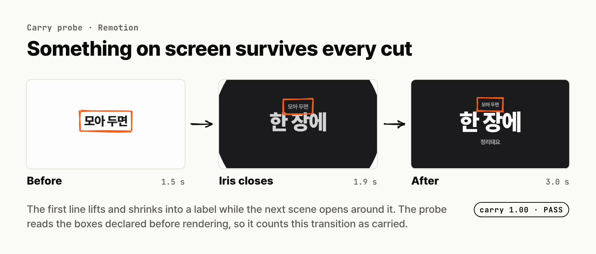
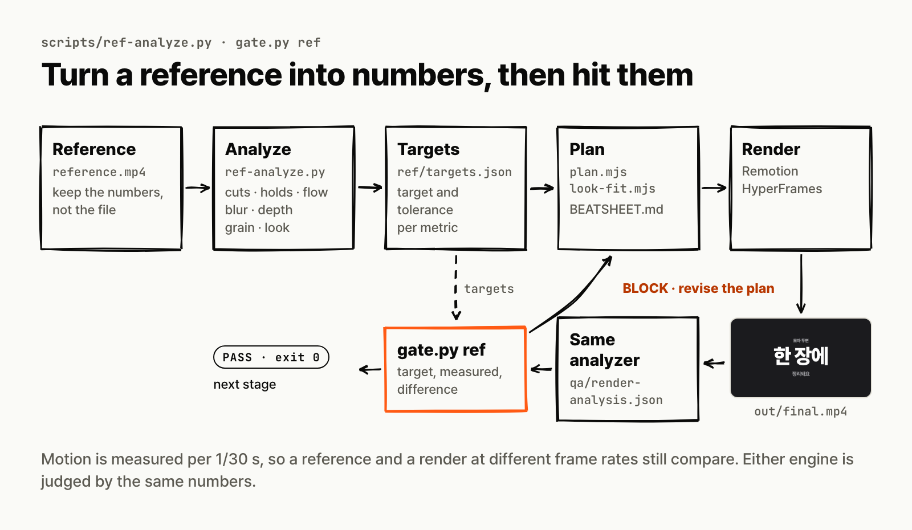
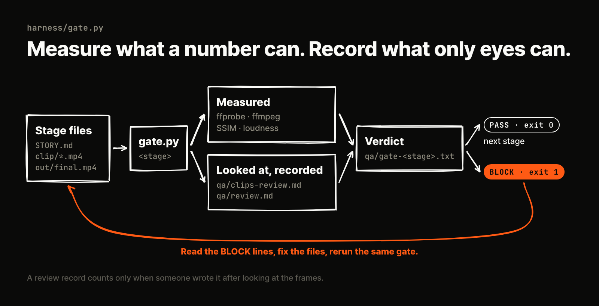
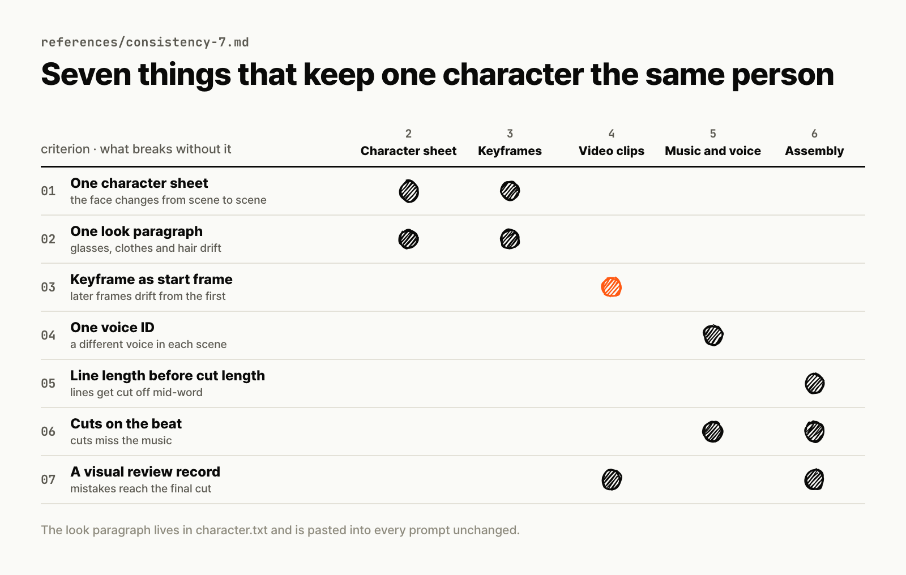

# motion-video-production

**English** · [한국어](README.ko.md)

[](https://github.com/unclejobs-ai/motion-video-skill/stargazers) [](LICENSE) [](docs/runtimes.md)


An **Agent Skill** for making 15–90 second motion graphics, promo and character videos with music and voice, where **every stage is checked before the next one starts**. It ships a reference-video analyzer, seven stage gates and two render engines (Remotion, HyperFrames). Codex, Claude Code and other skill-capable runtimes use the same skill folder.

**Jump to** · [Why gates](#why-gates) · [Quick start](#quick-start) · [Installation](#installation) · [What's inside](#whats-inside) · [Timeline editor](#timeline-editor) · [Reference analysis](#reference-analysis) · [Workflow](#workflow) · [Harness](#harness) · [Seven consistency criteria](#seven-consistency-criteria) · [Gotchas](#gotchas) · [Reference docs](#reference-docs) · [Required tools](#required-tools) · [Known limitations](#known-limitations) · [Verification scope](#verification-scope)

## Why gates

Generated video fails quietly. The first frame matches the keyframe, and a second later the jacket is different. Cuts land a little off the beat. A line of dialogue runs past its shot. "Looks fine" is not something an agent can be held to, so the skill turns each stage into files a script can check.

- **Measured** where a number works: duration, frame count, start-frame SSIM, beat grid, loudness, true peak and the reference metrics.
- **Recorded** where only eyes work: the gate blocks until someone writes a review after looking at the frame strips.
- **Exit codes**, not opinions: `0` moves on, `1` lists the lines to fix.

## Quick start

After installing the skill (see [Installation](#installation)), copy an engine into a working folder and render a demo. Node.js 24 or newer and ffmpeg are required. Do not run `npm ci` inside the skill folder. The commands below took about 28 seconds on a MacBook Air M3, including engine dependency installation with a cached browser.

```bash
SKILL_ROOT="$PWD/.agents/skills/motion-video-production"   # your actual install path
# Find it: ls -d .agents/skills/motion-video-production .claude/skills/motion-video-production ~/.agents/skills/motion-video-production ~/.claude/skills/motion-video-production 2>/dev/null
# Personal install: use "$HOME/.agents/skills/motion-video-production" or "$HOME/.claude/skills/motion-video-production"
# mkdir stops if engine/ already exists. Remove it or pick another name (cp -R into an existing folder nests engine/remotion)
mkdir engine && cp -R "$SKILL_ROOT/engines/remotion/." engine && cd engine && npm ci
# Check carry across cut transitions
node pipeline/probe.mjs productions/carry-demo              # carry 1.00 PASS
node pipeline/render.mjs carry-demo --stills 1.5 3.0        # renders/carry-demo/contact.png
node pipeline/render.mjs carry-demo                         # renders/carry-demo/picture.mp4
node pipeline/score.mjs productions/carry-demo              # procedural score
# <picture> <fps> <seconds> <music> <voice, - for none> <output>
bash "$SKILL_ROOT/scripts/mix-mux.sh" renders/carry-demo/picture.mp4 60 5 productions/carry-demo/audio/score.wav - out/final.mp4
bash "$SKILL_ROOT/scripts/verify.sh" out/final.mp4
```

This renders the 5-second typography demo below (silent GIF; the finished mp4 has music and no voice, and the on-screen text is Korean). For character and voice production, start at [First request](#first-request).


Carry is the share of cut transitions where at least one on-screen element continues into the next shot. In the demo, the first line rises and shrinks into the label of the next scene, so the probe scores 1.00.



Rendering uses `CHROME_PATH` or a cached Playwright headless shell. If neither exists, `npx remotion browser ensure` downloads one (the agent asks before downloading).

## Installation

Run this in the project folder where you want to use the skill. It requires Node.js and npx; select the runtimes you use.

```bash
npx skills add unclejobs-ai/motion-video-skill --skill motion-video-production
```

To target Codex only, run the command below. Add `--global` for personal scope.

```bash
npx skills add unclejobs-ai/motion-video-skill --skill motion-video-production --agent codex
```

The [Vercel skills CLI](https://github.com/vercel-labs/skills) handles install locations for Codex, Claude Code, Gemini CLI, Cursor, GitHub Copilot, OpenCode, Amp, Antigravity, Windsurf, and others. The engines live inside the skill folder, so they install with it. **Installer compatibility is not the same as full video-production validation.** See [runtime installation, invocation, and verification scope](docs/runtimes.md).

<details>
<summary><strong>Manual installation (without Node.js)</strong></summary>

Codex reads skills from project `.agents/skills/` and personal `~/.agents/skills/`. This example is a personal installation.

```bash
git clone https://github.com/unclejobs-ai/motion-video-skill.git
mkdir -p ~/.agents/skills
cp -r motion-video-skill/skills/motion-video-production ~/.agents/skills/
```

Claude Code reads skills from project `.claude/skills/` and personal `~/.claude/skills/`.

```bash
git clone https://github.com/unclejobs-ai/motion-video-skill.git
mkdir -p ~/.claude/skills
cp -r motion-video-skill/skills/motion-video-production ~/.claude/skills/
```

To use it in one project only, copy the same folder into that project's runtime skill directory. Do not install the same name through several paths in one runtime.

</details>

### First request

After installation, confirm that `motion-video-production` appears in the runtime's skill list. If it does not, restart the runtime. Invoke it with `$motion-video-production` in Codex or `/motion-video-production` in Claude Code and Cursor, or ask:

> I want a 20-second promo video that feels like this reference video.

The agent first asks six things (publication type, length and aspect ratio, available tools, prohibited elements, reference video, engine) and proceeds stage by stage. Without generation tools, it hands you prompts and continues from the files you generate.

The agent answers in your language. Gate output and most reference docs are written in Korean; agents read them as they are, and `STORY.md` keeps its Korean field names because the gates read them.

## What's inside

| What | What it does | Where |
|---|---|---|
| Remotion engine | Pinned render pipeline, motion modules, demos | `engines/remotion/` |
| Carry probe | Measures, before rendering, whether an on-screen element continues across each cut transition | `pipeline/carry.ts`, `probe.mjs` |
| Wordcut template | One word held in one slot while scenes hand it over. Edit only `data.ts` | `productions/wordcut/` |
| Look fit | Fits lens values to a reference's contrast, colour, grain and depth of field | `look-fit.mjs` |
| Voice and music | ElevenLabs and Fish Audio voices via the composio CLI, a procedural score on the timing | `vo.mjs`, `score.mjs` |
| HyperFrames engine | Animates plain HTML/CSS pages with GSAP and renders them to mp4 | `engines/hyperframes/` |
| Reference analysis | Takes a reference video apart with OpenCV into target numbers | `scripts/ref-analyze.py` |
| Timeline editor | Picture, text, voice and music tracks in the browser; edits `edit.json`, rebuilds the mp4 | `timeline/` |

The engine is swappable. Use Remotion when you need carry and wordcut, HyperFrames when the source material is web pages. The comparison is in [`references/engines.md`](skills/motion-video-production/references/engines.md).

## Timeline editor

The finished edit opens as four tracks: picture, text, voice and music. Move a cut point, retime or rewrite a caption, slide a line of dialogue, set gain and fades, then rebuild the mp4. No install beyond Node.js and ffmpeg.

```bash
node "$SKILL_ROOT/timeline/serve.mjs" "$PROJECT_ROOT"     # opens the editor in your browser
```


- **One file, two editors.** The browser and the agent change the same `edit.json` through the same core (`timeline/apply.mjs` for the agent). Each sees the other's edit within two seconds; undo works on both.
- **The gate is live.** The pill in the top bar runs the edit gate's timing checks on every change: cuts on the beat, no gaps, each line inside its cut. The item at fault turns orange.
- **Build is the same as the agent's.** `timeline/build.mjs` cuts the sources frame-exact, mixes every sound with its gain and fades (music ducks under voice) and writes captions as a subtitle track and `out/captions.srt`.

Format, ops and limits: [`timeline/README.md`](skills/motion-video-production/timeline/README.md).

## Reference analysis



"Make it like this video" is usually about motion and editing more than texture. Stage 0 takes the reference apart with OpenCV and records cuts and holds, optical flow, blur, depth of field, grain and look as numbers. The plan cites those numbers. After rendering, the same analysis measures the result, and `gate.py ref` lists target and difference per metric and blocks when one is out of range.

Run this from your project folder, not `engine/`. Set `SKILL_ROOT` as in Quick start.

```bash
SKILL_ROOT="$PWD/.agents/skills/motion-video-production"   # your actual install path
PROJECT_ROOT="$PWD"   # output folder containing reference.mp4 and ref/
python3 -m venv .venv && . .venv/bin/activate && python3 -m pip install -r "$SKILL_ROOT/scripts/requirements-ref.txt"
mkdir -p ref qa && cp -n "$SKILL_ROOT/templates/ANALYSIS.md" ref/ANALYSIS.md   # fill the <...> blanks from the analysis
python3 -I "$SKILL_ROOT/scripts/ref-analyze.py" reference.mp4 -o ref/analysis.json --targets ref/targets.json
python3 "$SKILL_ROOT/harness/gate.py" ref "$PROJECT_ROOT"
```

Motion is measured per 1/30 s, so different frame rates compare. The reference file is never committed; only the numbers are kept. Metric explanations and a worked example are in [`references/reference-analysis.md`](skills/motion-video-production/references/reference-analysis.md).

## Workflow


1. The skill creates the stage outputs (`ref/`, `STORY.md`, `character.txt`, `key/`, `clip/`, `voices.json`, `edit.json`).
2. Set `SKILL_ROOT` to the parent folder of the installed `SKILL.md` and `PROJECT_ROOT` to the output folder. After each stage, run `python3 "$SKILL_ROOT/harness/gate.py" <stage> "$PROJECT_ROOT"`.
3. Exit code 0 moves to the next stage. Exit code 1 (BLOCK) means: read the BLOCK lines in `qa/gate-<stage>.txt`, fix the output, and rerun the same gate.
4. Checks that need human eyes cannot be judged by a script. They pass only with a record written after looking at the frames (`qa/clips-review.md`, `qa/review.md`).

The start frame can match, yet the character may change a second later (G01). `gate clips` creates `qa/strip-<clip>.png` for each clip.


A `gate.py clips` run (gate output is in Korean). Without a visual review record it returns BLOCK (exit code 1); after the record is written it returns PASS (exit code 0).


## Harness



| Production stage | Gate | Checks |
|---|---|---|
| 0. Reference analysis | `ref` | Before planning: blanks in ANALYSIS.md, targets.json format. After rendering: each metric against its target |
| 1. Story and scene planning | `story` | Blanks, BPM, music sync table, scene table |
| 2. Character sheet | `character` | Whether `character.txt` is one paragraph, color descriptions, sheet image |
| 3. Keyframes | `keyframes` | Duplicate files, aspect ratio against clips |
| 4. Video conversion | `clips` | Duration, frame count, start-frame match, frame strip, per-clip verdicts |
| 5. Music and voice | `audio` | One voice ID, dialogue files |
| 6. Assembly | `edit`, `final` | Beat grid, cut continuity, repeated cuts, dialogue length, frame count, audio, loudness, true peak, review record |

Gates read only the stage outputs and the finished mp4, never engine internals, so the standard is the same whichever engine made it.

Similarity values such as SSIM cannot tell a person's motion from deformation (`gotchas.md` G02). The gate checks only the start-frame match numerically and asks a person to review the frame strips and record the later frames.

From the repository folder, run `bash skills/motion-video-production/harness/selftest.sh`. To check an installed copy, run `bash "$SKILL_ROOT/harness/selftest.sh"`. Exit code 0 means the cases behave as expected on this computer.

## Seven consistency criteria

Where the seven criteria that keep faces and voices consistent across scenes sit in the production stages is shown below and in [`references/consistency-7.md`](skills/motion-video-production/references/consistency-7.md).



## Gotchas

All 29 are in [`references/gotchas.md`](skills/motion-video-production/references/gotchas.md) with symptoms, causes, prevention, and check IDs. Engine pitfalls are in [`references/pitfalls.md`](skills/motion-video-production/references/pitfalls.md). Common ones:

- Set cut lengths in beats, and round start frames once from cumulative time. (G11, G12)
- Measure dialogue length before setting cut length. (G13)
- Piping a check through `| tail` loses its exit code. (G21)
- A smooth scene change where nothing survives still scores carry 0.00. Move one element across the cut transition.

## Reference docs

They ship inside the installed skill folder. The agent reads the one each stage needs; most are in Korean.

| Doc | What it covers |
|---|---|
| [`SKILL.md`](skills/motion-video-production/SKILL.md) | Skill instructions: stage order, the six opening questions, gate calls |
| [`references/reference-analysis.md`](skills/motion-video-production/references/reference-analysis.md) | Reference analysis metrics and building targets |
| [`references/engines.md`](skills/motion-video-production/references/engines.md) | Remotion vs HyperFrames, per-engine commands |
| [`references/art-direction.md`](skills/motion-video-production/references/art-direction.md) | Carry, motion vocabulary, holding one style |
| [`references/glossary.md`](skills/motion-video-production/references/glossary.md) | Editing, camera and texture terms (Korean and English) |
| [`references/beat-grid.md`](skills/motion-video-production/references/beat-grid.md) | Cut lengths from BPM |
| [`references/consistency-7.md`](skills/motion-video-production/references/consistency-7.md) | Seven character consistency criteria |
| [`references/brand-intro.md`](skills/motion-video-production/references/brand-intro.md) | A brand intro video plus a one-page homepage |
| [`references/providers.md`](skills/motion-video-production/references/providers.md) | Notes on image, video and voice tools |
| [`references/cost-rules.md`](skills/motion-video-production/references/cost-rules.md) | Free first, paid only where needed |
| [`references/gotchas.md, pitfalls.md`](skills/motion-video-production/references/gotchas.md) | Common gotchas and mistakes |
| [`references/licensing.md`](skills/motion-video-production/references/licensing.md) | External tool licenses and check dates |
| [`templates/`](skills/motion-video-production/templates/) | Stage output forms such as STORY.md, ANALYSIS.md, BEATSHEET.md |

## Required tools

Free tiers and commercial-use conditions are in [`NOTICE.md`](NOTICE.md) and [`references/licensing.md`](skills/motion-video-production/references/licensing.md) (with source URLs). Remotion needs a Company License for for-profit organizations with four or more employees; HyperFrames is Apache-2.0. Terms change often, so check them right before work.

| Tool | Purpose |
|---|---|
| Codex, Claude Code, or another skill-capable agent | Running production and assembly |
| ffmpeg, ffprobe, Python 3, Bash | Running the harness and scripts (WSL on Windows) |
| Node.js 24 or newer | Engines (Remotion 4.0.529, HyperFrames 0.8.143, pinned) |
| OpenCV, numpy (`scripts/requirements-ref.txt`) | Reference analysis |
| ChatGPT / Grok Imagine | Image and video generation |
| ElevenLabs, Fish Audio (composio CLI) | Voice |
| whisper | Transcription review |

## Known limitations

- **The carry probe is Remotion-only.** It reads the boxes declared before rendering (`track.ts`). HyperFrames renders are measured on the mp4 with `verify.sh`, `gate.py final` and `gate.py ref`. There is no mp4-side carry measurement yet.
- **The wordcut demo is an untuned first render.** Against the reference targets, `gate.py ref` blocks 10 of 12 metrics; grain, sharpness ratio and contrast are furthest off. Re-running `look-fit.mjs` and `plan.mjs` to close that gap is how the skill is meant to be used.
- **A closing image drops the carry score to 0.00 (FAIL).** The only counted boundary is the one where the image covers the page, and it counts as bare; the other detected boundary is exempt as a declared cut. Turn that boundary into a carry to get out of FAIL.
- **The full text of the GSAP license clauses was not verified.** GSAP 3.14.2, used by the HyperFrames demo, says in its README that it is free including commercial use. Before releasing a commercial video, check https://gsap.com/standard-license.

## Repository structure

```
README.md, README.ko.md     English (default) and Korean READMEs
NOTICE.md, LICENSE          External tool notice, MIT
docs/                       README images, diagram sources (docs/diagrams, Uncle Jobs design system), runtime install and verification scope
skills/motion-video-production/        Skill folder to install (everything below is copied together)
  SKILL.md                  Skill instructions
  references/               reference analysis, engines, art direction, consistency, beat grid, tool notes, gotchas, licensing
  harness/                  gate.py (per-stage verdicts), selftest.sh (harness self-validation)
  scripts/                  ref-analyze.py, mix-mux.sh, verify.sh, key-plate.sh, clipsheet.sh and more
  templates/                ANALYSIS.md, STORY.md, BEATSHEET.md, MUSIC_BRIEF.md and more
  engines/remotion/         carry demo, wordcut template, render, voice and score pipeline
  engines/hyperframes/      HTML/GSAP carry demo
  timeline/                 timeline editor (browser), apply.mjs (agent edits), build.mjs (edit.json -> mp4)
```

## Verification scope

On 2026-10-25 the committed tree was exported and installed as is. All 76 skill files installed. Engine `npm ci`, typecheck, 13 tests, the carry probe and the selftest passed. Renders in both engines were measured with `verify.sh` and `gate.py ref`, and the HyperFrames render passed `gate.py final`. Not checked: external generation, voice credits, listening to audio, and invocation inside the seven other runtimes. Details are in [docs/runtimes.md](docs/runtimes.md).

## Built by

This skill distills the review criteria the team behind [SceneSteller](https://www.scenesteller.com/?utm_source=github&utm_medium=readme&utm_campaign=motion-video-skill) built up while producing videos. If you'd rather go from story to finished video right in your browser, try it in SceneSteller.

## Rights and responsibilities

Rights and responsibilities for generated outputs are described in [`NOTICE.md`](NOTICE.md) and [`references/licensing.md`](skills/motion-video-production/references/licensing.md).
